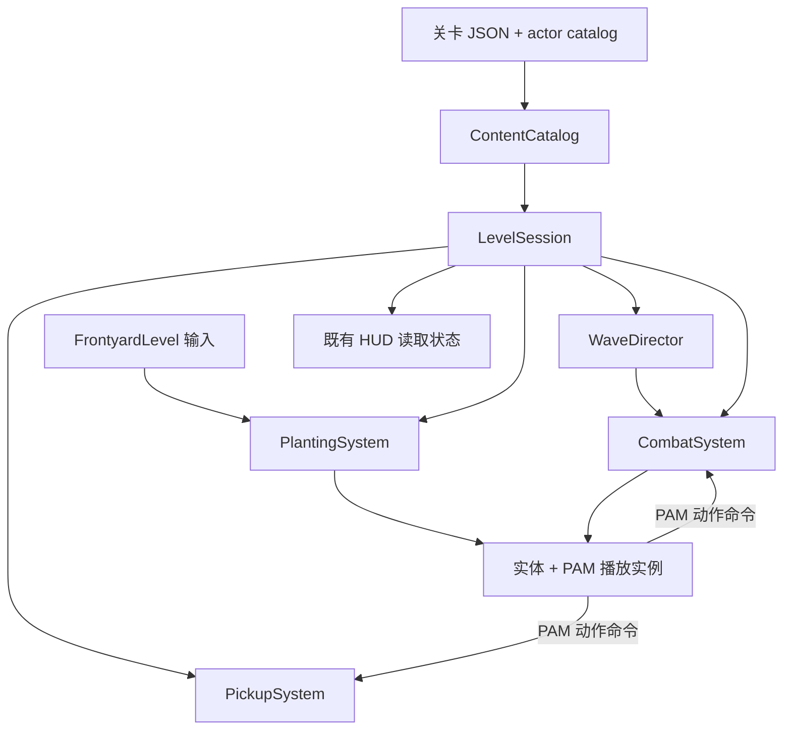

# 游戏工程底层架构

## 决定与范围

继续使用 Godot 4 原生 Node、信号和 Resource，保留当前前院场景、登录/过场、原版图片与 PAM 运行时。底层按实际职责拆分；当前没有引入 ECS、全局事件总线、万能属性系统或另一套引擎。此文记录已实施的基础，不代表完整游戏内容已经完成。

## 实际模块

| 模块 | 所有权与接口 |
| --- | --- |
| `scripts/runtime/content_catalog.gd` | 用 Godot JSON 读取关卡及 actor catalog，检查版本、必要引用、出生范围与重复格子，错误在创建实体前报告。`load_content(level_path) -> Error`。 |
| `scripts/runtime/level_session.gd` | 单局状态、实体集合、固定 60 Hz 累积时钟、局部随机数、重开与胜负。提供 `initialize_run`、`start_level`、`advance_seconds`、`reset_level`，发出 `phase_changed`、`run_reset`。不访问 HUD 或输入。 |
| `scripts/runtime/planting_system.gd` | 扣费、冷却、占格、铲除、植物生成及信号连接。 |
| `scripts/runtime/combat_system.gd` | 同行目标查询、实体更新、僵尸生成、割草车、弹体生成/移动/命中及失败线。 |
| `scripts/runtime/pickup_system.gd` | 局部 RNG 的天空阳光、植物产阳光、移动/寿命/拾取。 |
| `scripts/level/wave_director.gd` | 独立数据时间表，发出 `spawn_requested`、`wave_changed`；时间表结束且无活敌才胜利。 |
| `scripts/level/lawn_unit.gd`、`lawn_plant.gd`、`lawn_zombie.gd` | Godot 实体的生命、动作及表现；植物动作由现有 PAM 命令请求发射/产阳光。 |
| `scripts/level/level_01.gd` | `FrontyardLevel extends LevelSession`，负责既有场景的 HUD 接线、鼠标/快捷键和种植预览。 |
| `scripts/pam_animation_asset.gd`、`pam_player.gd` | 共享离线转换资源与逐实体播放实例，统一由关卡推进；与玩法目录和关卡 JSON 分离。 |
| `scripts/ui/` | 登录、世界/关卡地图与场景过场；地图只负责选择与导航，不创建或推进单局。 |

系统为每局创建的 RefCounted 对象，持有所属场景 Node，不持有全局单例状态。关卡 Node 拥有实际实体与表现节点。清理集中在 `reset_level()`：隐藏并 queue_free 子节点、清空集合、恢复经济/波次/时钟/局部 RNG，再重建初始阵型与割草车。暂停不推进任何游戏或 PAM 时间。

## 数据流

每个固定步按冷却 → 波次 → 天空阳光 → 实体/割草车/弹体 → 拾取物 → 结算推进。渲染帧不足一步的时间会累积；倍率由场景传入时间控制。准备状态只推进植物展示动画。

## 内容配置与扩展

- `data/levels/level_01.json` 已迁移到 `schema_version: 1`，含 `actor_catalog`、`deck`、`board`、`random_seed`、初始阵型、波次、天空阳光与拾取参数。第一关原数据数值保持。
- `data/actors.json` 保存角色属性、动画 Resource 路径、行为及弹体数据。当前支持 `sun`、`shoot`、`block` 三种植物行为，僵尸支持行走/啃咬。
- 新关卡复用现有场景契约：根节点使用 FrontyardLevel/LevelSession 派生脚本，子节点包含 `PlantingGrid`、`Actors`、`Projectiles`、`Pickups`；FrontyardLevel 还需要 `HUD/LevelHUD`。在 Inspector 设置 `level_path`，无需复制战斗循环。
- 新植物若使用已有行为，可增加 actor 数据、PAM `.tres` 和关卡牌组；新行为实际实现于实体与相应系统。现有 HUD 布局为当前三卡界面，更多卡片需要后续 UI 排版。
- 新弹体的贴图、速度、显示比例、命中半径及移除边界由 `projectile` 配置控制。目前实现直线同行伤害；溅射、追踪等应增加相应行为。
- 现有 `FrontyardLevel` 公共数组、种植/拾取/刷怪方法仍可调用，原验证与 HUD 已迁移到实际 session 数据，PAM 实验室保持独立。

## 世界与选关入口

实际流程为 `login.tscn` → `world_map.tscn`（世界轮播 → 可滑动关卡地图）→ `level_01.tscn`。跨场景切换沿用 `SceneTransition` 自动加载和加载花；地图内部用 `WorldMapScreen.View` 切换两个原生 Control 面板。已接入 Gardendless 的 13 个常规世界、793 个地图节点及 780 条连接；只有前院 `modern1` 对接本地第一关，默认开放，其他节点可查看但不能开始关卡。

`scenes/world_map.tscn` 的 `ReferenceCanvas` 保存可编辑的视口、标题、按钮、滑块和详情面板。`WorldMapScreen.catalog_path` 指向 `data/adventure/worlds.json`，各世界引用独立地图 JSON。`AdventureCatalog` 校验版本、节点 ID、路径和实际场景引用；节点 `scene` 选择目标场景，`level_id` 关联本地通关记录，`requires` 可引用前置通关 ID。新增关卡沿用此契约及既有 `LevelSession`，无需复制地图或战斗控制器。

`MapPanView` 为世界轮播和地图复用同一个裁剪拖动视口，处理鼠标/触摸、拖动阈值、视口外释放、惯性、边界及轮播吸附，提供 `tapped`、`position_changed`、`gesture_finished` 和 `pan_to`。`WorldMapCanvas` 实例化带 Sprite2D 与 AnimationPlayer 的岛屿场景，按原 `offsetScale` 更新远近景，裁去视口外装饰并暂停其动画；`MapLevelButton` 提供选择、焦点及锁定/通关状态。滑块浏览全图，定位按钮回到选中节点；方向键、Home/End 选择，Esc 逐级返回。点击节点只选择，“开始关卡”才切场。地图按 1024×640 基准等比适配。

`AdventureProgress` 是独立 Resource，以 ConfigFile 写入 `user://adventure_progress.cfg`，记录当前世界、各地图偏移、选中节点及已通关 ID。`FrontyardLevel` 监听自身 `phase_changed`，胜利时记录 `map_level_id`，重开不清除通关状态。地图和关卡可通过各自的 `progress_path` / `map_progress_path` 选择配置，空值使用 `AdventureProgress.active_profile_path`；验证脚本用独立配置，不修改玩家存档。

`scenes/frontyard_map.tscn` 继承同一地图，将 `initial_view` 设为 `LEVELS`，使战斗返回时直接显示选关。HUD 的 `map_requested` 信号由 `FrontyardLevel.return_to_map()` 接收，`map_scene_path` 指定返回目标；按钮位于底栏、暂停和胜负窗口。离开时停止单局推进，切换失败恢复此前暂停状态；再次进入由场景重新创建完整初始单局。`LevelSession` 和战斗系统不依赖地图。

地图数据来自固定提交 `462f1161d5a29423409002936f2e05f1c24ac630` 的真实 Cocos prefab。`Tools/export_world_map_reference.py` 读取原生节点和资源，`Tools/sample_world_map.mjs` 用官方 DragonBones core 按原帧率求值，并生成复用的 Sprite2D/AnimationPlayer 场景，`Tools/prepare_adventure_maps.py` 输出 `data/adventure/` 和带来源哈希的图集子集。运行时使用原生 Godot 节点，不加载 Cocos 或 DragonBones。岛屿与世界图标保留原配置 idle 动作，转为 Godot 原生轨道；轮播缩放、页面淡入及地图交互由 Godot 驱动。来源与复现命令见 `assets/ui/adventure/SOURCE.md`，早期手工单岛资源已不用于实际地图。

## 植物卡片预览

`scenes/plant_preview.tscn` 为可独立运行和嵌入的实际界面。地图 `open_plant_preview(id)` 隐藏原页面、关闭地图输入并创建预览页，返回释放页面并恢复原地图和焦点。预览由 PlantPreviewCatalog、可复用 PlantCard、PlantAnimationPreview 和 PlantPreviewScreen 组成。ContentCatalog.load_actor_catalog(path) 复用战斗的角色读取/校验；展示目录只保存顺序、介绍及比例；动画资源共享、播放实例独立，展示命令不连接战斗。完整接口和数据契约见 `docs/plant-preview.md`，供其他 AI 使用的 skill 为项目 `.agents/skills/pvz2-plant-preview/SKILL.md`。

参考 Gardendless 实际 AlmanacPlantPage、CardFeature、CardSelectAlmanac 及原生展开的场景/prefab；展示窗贴图复用原资源，布局和卡片状态使用 Godot 原生控件。当前覆盖三种已接入植物，支持搜索、分类、属性、暂停和动作/受损演示；未接玩家解锁、服装、升级或卡组编辑。

## 第三方参考依据

战斗模块借鉴职责边界；地图另使用真实 prefab 布局与资源，交互由 Godot 实现。

- 实读 `reference/research/pvzge_web-readonly/docs/assets/main/index.js` 的真实 `System.register("chunks:///_virtual/...ts")` 模块：`Plant` 与 `Zombie` 各自处理生命及状态，`FrontYard` 管泳道环境，`ProjectileManager` 管生成，`Levels.getLevelJson` 从资源读取 JSON。由此采用实体/草坪/弹体/关卡数据分离。`AnimationController` 使用 Cocos `ArmatureDisplay` 和 `playAnimation`，故没有迁入其 DragonBones/Cocos 调用，也没有把其作为 PAM 播放器。
- 实读 `reference/MinecraftVsZombies2Unity-inspection/Assets/Scripts/Vanilla/GameContent/Stages/Behaviours/WaveStageBehaviour.cs`：`PrepareForBattle/Start/Update` 区分准备、开始与逐帧推进；波次以独立状态和计时器控制；最终波与存活敌人共同决定结束。借鉴单局生命周期和波次独立边界。此本地参考只含该源码摘录、`.gitmodules`、包清单和说明；没有假定子模块引擎完整可用，也没有复制其属性注册/回调框架。
- 详细范围和许可证据见 `reference/GARDENDLESS_RESEARCH.md`、`SOURCE_RESEARCH.md`、`ADDITIONAL_SOURCES.md` 及地图 `assets/ui/adventure/SOURCE.md`。战斗参数仍为本地测试关卡。

## 尚未实现

完整游戏还需其余地图节点对应的可玩关卡与奖励、史诗世界、内容版本迁移、商店与完整图鉴进度、更多植物和敌人行为、护甲/状态效果、地形/叠种、旗帜波/清场提前推进/特殊关卡、音频系统及完整移动端界面。当前存档覆盖地图偏好与本地通关 ID；战斗波次仍使用既有累积时间表。网格是一格一株，目标查询仍遍历小规模实体集合，表现与 Godot Node 绑定；未来按实际性能和玩法增加索引或组件，不预先构建通用引擎。关卡 JSON 是项目内容格式，校验覆盖当前运行契约，不是通用 JSON Schema 服务。

## 验证

团队开发测试场景为 scenes/development_sandbox.tscn，继承 level_01.tscn，脚本 DevelopmentSandbox 继承 FrontyardLevel。它提供目录选择、手动刷怪及经济/冷却辅助，复用同一会话、实体与战斗系统；LevelSession.automatic_victory 默认 true，测试场景设 false 以允许持续空场测试。测试场景不写地图通关记录。教程见 ../docs/开发测试关卡.md，验证入口为 scripts/tests/verify_development_sandbox.gd。

使用项目内 Godot 4.7.2：headless 编辑器扫描/类注册通过；已有 `scripts/tests/verify_level_01.gd` 实际场景回归通过，覆盖种植边界/占格/扣费/冷却、阳光/铲除、暂停、共享 PAM、动画事件射击/产阳光、啃咬、完整三波胜利、割草车消耗后失败与重开。此次另加入不足一步的时间累积检查。没有执行打包、发布或导出。

地图的实际导航验证入口为 `scripts/tests/verify_world_map.gd`，覆盖 13 个地图实际创建及 idle 轨道实际更新、真实鼠标/触摸输入、节点上起拖及视口外释放、惯性和两端边界、世界滚轮吸附、锁定节点、第一关进入、暂停返回及偏移恢复、加载失败恢复、全新单局、通关持久化与主菜单返回。可视截图和运行记录位于外层 `Artifacts/world-map/`。未执行打包、发布或导出。
